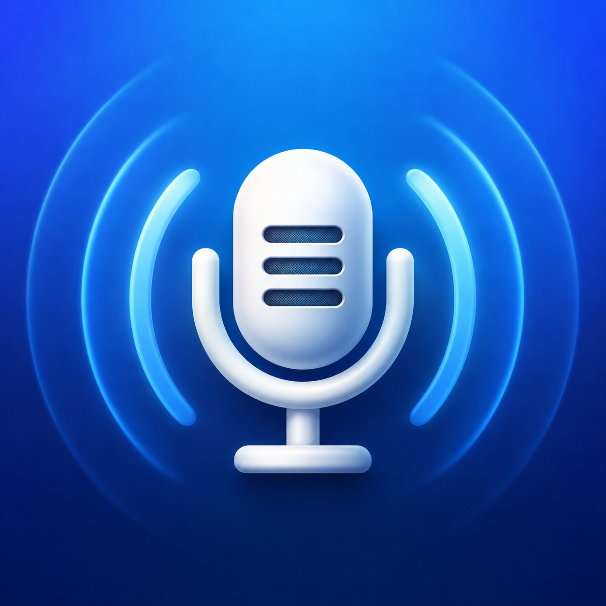

<p align="center">
  
</p>

<h1 align="center">MeetingRecorder</h1>

<p align="center">
  A private, Apple-native meeting recorder with separate app and microphone tracks,<br>
  on-device English/French transcription, and speaker diarization.
</p>

<p align="center">
  
  
  
  
</p>

MeetingRecorder captures the audio of one macOS application with ScreenCaptureKit and records the selected microphone at the same time. It creates a normal mixed recording, a two-track source master, and an optional local transcript—without a meeting bot, virtual audio device, cloud transcription service, or upload.

> [!IMPORTANT]
> This is a source-first personal project. Builds are self-signed for private installation and are not notarized. Review the [privacy and platform limitations](#privacy-and-platform-limitations) before recording a real meeting.

## Highlights

- Native ScreenCaptureKit capture for application audio and microphone input.
- Two independent AAC source tracks: `Meeting` for the selected app and `You` for the microphone.
- A convenient mixed M4A for Finder, QuickTime, and ordinary audio players.
- On-device English/French transcription through [Argmax OSS](https://github.com/argmaxinc/argmax-oss-swift), using WhisperKit and SpeakerKit.
- Speaker diarization for the meeting track; microphone speech always stays labelled `You`.
- Scriptable `start`, `stop`, `toggle`, `status`, `list`, `config`, and `transcribe` commands.
- Raycast Script Commands, atomic state, fragmented capture files, and recovery after an interrupted session.
- No notification banners while capture is active, so a shared screen cannot expose recorder status.

## What a recording contains

Every retained session gets a timestamped folder:

```text
~/Meetings Recordings/
└── 2026-08-03_10-30-00_Google-Meet/
    ├── 2026-08-03_10-30-00_Google-Meet.m4a
    ├── 2026-08-03_10-30-00_Google-Meet.sources.mov
    ├── transcript.md
    ├── transcript.raw.md              # debug mode only
    └── meeting-recorder.debug.log     # debug mode only
```

The M4A is a stereo mix. The audio-only MOV is the transcription master: track 1 is application output and track 2 is microphone input. MOV is used because AVFoundation supports independently named AAC tracks there. Recordings shorter than `minimum-duration`—30 seconds by default—are discarded with their empty session folder.

## Requirements

- An Apple Silicon Mac running macOS 15 or later.
- Full Xcode 16 or later to build. Installed copies do not need Xcode.
- Microphone and Screen & System Audio Recording permission on each Mac.
- Internet access for the first transcription model download. Processing after download is local.

## Quick start

Clone the repository, open a terminal in it, then create a long-lived local signing identity, build, and install:

```sh
Scripts/create-local-signing-certificate.sh
Scripts/build-app.sh
Scripts/install.sh
~/.local/bin/meeting-recorder setup
```

The certificate command adds a self-signed identity named `MeetingRecorder Local Code Signing` to the login keychain. macOS may request authorization. Keep that identity stable across rebuilds so macOS has the best chance of preserving privacy grants.

List available sources and make a first recording:

```sh
~/.local/bin/meeting-recorder list
~/.local/bin/meeting-recorder start --app "Google Meet"
~/.local/bin/meeting-recorder status
~/.local/bin/meeting-recorder stop
```

The default output location is `~/Meetings Recordings`, outside Documents and iCloud Drive.

## CLI

| Command | Purpose |
|---|---|
| `meeting-recorder setup` | Create local data directories and request permissions. |
| `meeting-recorder list [--json]` | List shareable apps and windows. |
| `meeting-recorder start [selector]` | Start recording and return after both inputs are ready. |
| `meeting-recorder stop` | Finalize the active recording and return its path. |
| `meeting-recorder toggle [selector]` | Start when idle; stop when recording. |
| `meeting-recorder status [--json]` | Show capture or transcription state and progress. |
| `meeting-recorder transcribe FILE [--wait] [--json]` | Transcribe an existing audio file. `--sync` aliases `--wait`. |
| `meeting-recorder config list [--json]` | Show effective settings. |
| `meeting-recorder config get KEY [--json]` | Read one setting. |
| `meeting-recorder config set KEY VALUE [--json]` | Validate and update one setting. |

Selectors are `--app NAME`, `--bundle-id ID`, or `--pid PID`. Use only one. Omitting a selector asks MeetingRecorder to choose an unambiguous meeting app or browser.

```sh
meeting-recorder start --bundle-id com.microsoft.teams2
meeting-recorder toggle --app teams
meeting-recorder transcribe ~/Downloads/interview.m4a --wait
```

Synchronous transcription writes progress to standard error and returns the transcript path, detected languages, and participant labels. If a recorder-produced M4A has a sibling `*.sources.mov`, retranscription automatically uses the two-track source so `You` remains distinct.

## Configuration

Settings are validated and written atomically to `~/Library/Application Support/MeetingRecorder/config.json`.

| Key | Accepted values | Default |
|---|---|---|
| `output-directory` | Writable path | `~/Meetings Recordings` |
| `transcription-model` | WhisperKit model identifier | `large-v3-v20240930_626MB` |
| `minimum-duration` | Nonnegative seconds; `0` keeps all recordings | `30` |
| `language` | `auto`, `en`, or `fr` | `auto` |
| `diarization` | `true` or `false` | `true` |
| `speaker-count` | `auto` or `1` through `20` | `auto` |
| `debug` | `true` or `false` | `false` |

Examples:

```sh
meeting-recorder config set language auto
meeting-recorder config set minimum-duration 10
meeting-recorder config set speaker-count 3
meeting-recorder config set debug true
```

`language auto` supports bilingual English/French recordings. Forcing `en` or `fr` can improve consistency for a mostly monolingual meeting; ordinary borrowed words are still decoded from the audio rather than translated. `speaker-count` is a diarization hint and is ignored when diarization is off.

Debug mode retains Whisper's raw timestamp/control-token transcript and a privacy-limited session log. The log includes capture levels, counters, chunk timing, detected language, diarization state, file lifecycle, and errors; it intentionally excludes transcript text and full meeting/window titles.

## Transcription behavior

Automatic post-recording transcription runs in the signed background agent. A new recording cannot begin while `status` reports `transcribing`. The recorder:

1. Transcribes app and microphone tracks independently.
2. Labels microphone passages as `You`.
3. Diarizes the complete app track into stable generic labels such as `Speaker 1` and `Speaker 2`.
4. Merges both streams chronologically into `transcript.md`.

If the application track is silent, the transcript contains only `You` passages. If diarization fails, the transcript is still saved with remote passages labelled `Meeting` and the failure is reported as a warning. Models are cached under `~/Library/Application Support/MeetingRecorder/Models/`.

After capture has ended, MeetingRecorder may show one replaceable silent progress notification followed by a completion, warning, or failure notification. It never posts notifications while capture is starting, recording, or finalizing.

## Raycast

Add `Raycast/` as a Raycast Script Commands directory, or copy its scripts into your existing commands directory. The `recorder` command accepts an optional app-name argument such as `meet` or `teams`; `recorder status` reports current state.

The scripts invoke the helper inside `~/Applications/MeetingRecorder.app` directly, so Raycast's restricted `PATH` is not a problem. Raycast can exit immediately after starting a session; the app owns the recording process.

## Install the same build on another Mac

Privacy permissions do not sync through iCloud. Build once, install the identical signed artifact on the second Mac, and grant permissions there separately:

```sh
Scripts/build-app.sh
Scripts/export-public-certificate.sh
```

Copy these files from `dist/` into one folder on the other Mac:

```text
MeetingRecorder.app
MeetingRecorder-Local-Code-Signing.cer
install-meeting-recorder.sh
uninstall-meeting-recorder.sh
meeting-recorder-toggle.sh
```

Then run `./install-meeting-recorder.sh`. It trusts the public certificate for the current user, installs the app and CLI, copies the Raycast toggle to `~/raycast-scripts`, and starts permission setup. The private key is not needed on the second Mac unless it will produce future builds. Never put a private `.p12` backup in iCloud Drive or this repository.

Self-signed apps are not notarizable. Gatekeeper may require Control-clicking `MeetingRecorder.app` and choosing **Open** on first installation. A future public release would need Developer ID signing and notarization.

## Privacy and platform limitations

- ScreenCaptureKit isolates audio by application, not by browser tab or window. Selecting Chrome or Safari captures all audio attributed to that browser, including other tabs and windows.
- A Chrome-installed Meet PWA can appear as a distinct shareable application while its audio belongs to the main Chrome process. Automatic selection therefore prefers the audio-owning browser and warns about browser-wide scope.
- MeetingRecorder never falls back to display-wide or all-system audio capture.
- Recordings and transcript audio are not uploaded. WhisperKit and SpeakerKit only access the network to obtain missing models.
- Selecting an iCloud-backed output directory allows macOS—not MeetingRecorder—to sync the generated files.
- Debug files can still reveal local paths, app identities, timing, and participant labels. Review and redact them before sharing.
- Speaker labels identify recurring voices within one recording; they do not determine real identities.

You are responsible for applicable recording laws, workplace policies, and participant consent.

## Recovery and data locations

The owner-only control socket and state live in `~/Library/Application Support/MeetingRecorder/`; rotating operational logs live in `~/Library/Logs/MeetingRecorder/`. Capture files use ten-second QuickTime fragments. On the next launch, the agent attempts to recover playable temporary files left by an unexpected exit.

The microphone selected at start is pinned for the session. A microphone disconnect, selected-app exit, sleep notification, SIGINT, or SIGTERM triggers bounded finalization instead of a secret device switch.

## Uninstall

```sh
Scripts/uninstall.sh
```

The default uninstall removes the user-scoped app, CLI symlink, and recognized Raycast scripts while preserving recordings, configuration, models, logs, permissions, signing identities, and backups. `Scripts/uninstall.sh --purge-data` also removes app support and central logs. Active work is protected unless `--force` is explicitly supplied. Recordings are never deleted.

## Development

```sh
Scripts/test.sh
Scripts/check-public-repo.sh
```

The first command runs the Swift test suite. The second checks shell/plist syntax, tracked files and branch/tag history for common private artifacts, obvious credentials, absolute home paths, and whitespace errors. GitHub Actions runs both checks on an Apple Silicon macOS 15 runner. Dependabot monitors the pinned Swift dependency graph and workflow actions.

Please read [CONTRIBUTING.md](CONTRIBUTING.md) before opening a pull request and [SECURITY.md](SECURITY.md) before reporting a vulnerability. Never attach a real recording, transcript, debug log, signing certificate, or private key to a public issue.

When publishing this local repository, push the intended branch explicitly. Do not use `git push --mirror`, because local tooling can maintain implementation checkpoint refs that are not part of the public branch:

```sh
git log --format='%h %an <%ae> %s'
# Configure your GitHub verified/noreply author identity before committing.
git remote add origin git@github.com:YOUR-ACCOUNT/meeting-recorder.git
git push -u origin HEAD:main
```

The first command is a deliberate privacy check: author names and email addresses are part of every published commit. If old metadata is unsuitable, rewrite it before the first push rather than after others have cloned the repository.

## License

MeetingRecorder is available under the [MIT License](LICENSE). Third-party components retain their own terms; see [AppResources/ThirdPartyNotices.txt](AppResources/ThirdPartyNotices.txt).

Downloaded [WhisperKit](https://huggingface.co/argmaxinc/whisperkit-coreml) and [SpeakerKit](https://huggingface.co/argmaxinc/speakerkit-coreml) model artifacts are not distributed in this repository. Review their model cards and hosting terms before use or redistribution.
